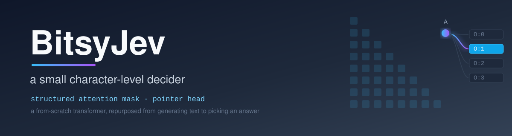
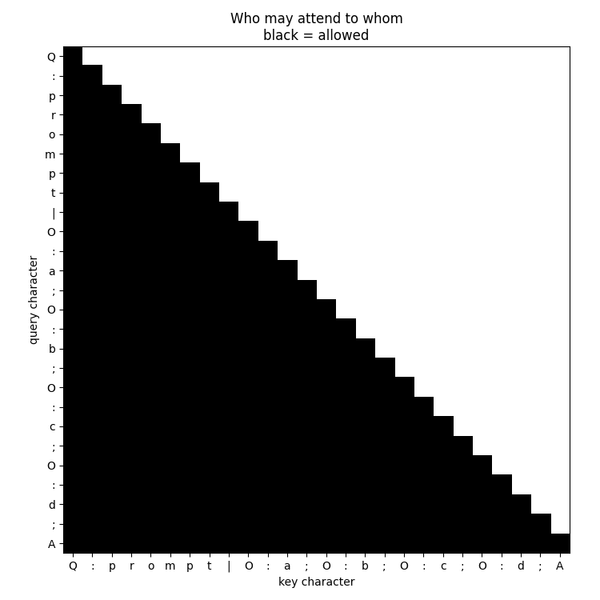
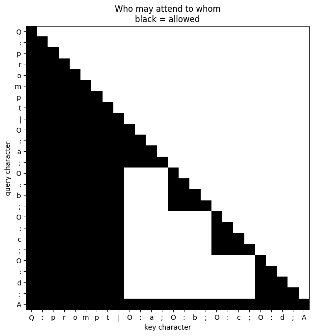

<p align="center">
  
</p>

# decider-model (MiniJev)

A small, character-level **decision model** built for learning purposes. It extends my
earlier from-scratch transformer, [BitsyGPT](https://github.com/spraja08/BitsyGPT),
and repurposes it from *generating* the next character to *pointing* at the correct
answer in a multiple-choice question.

> This project exists to understand how a transformer can be bent toward a decision
> task. It is not meant for production use.

## What changed from BitsyGPT

BitsyGPT is a standard decoder-only transformer: a causal attention mask plus an
`lm_head` that predicts the next character over the whole vocabulary. The decider keeps
the same backbone (token + position embeddings, multi-head self-attention, feed-forward
blocks, layer norm) but makes two deliberate changes:

1. **Structured (additive) attention mask instead of the plain causal mask.**
   The standard transformer allows every position to attend to every earlier position.
   The decider replaces that with a mask shaped around the prompt's structure
   (`StructuredAttentionMask`):
   - **Question/context characters** are shared and readable by everything downstream.
   - **Each answer option is its own branch**: an option can read the shared question
     and itself, but *not* the other options, so the branches stay independent.
   - **The decision state** (the final `A`) can read all earlier real characters.
   - Padding is blocked everywhere except its own diagonal.

   Blocked entries become `-inf` just before the softmax, so an option never leaks into
   a sibling option while the model forms its decision.

   The difference is easiest to see side by side, for the prompt
   `Q:prompt|O:a;O:b;O:c;O:d;A` (black = a read is allowed):

   <table>
     <tr>
       <th>Standard transformer (plain causal)</th>
       <th>Decider (structured / additive)</th>
     </tr>
     <tr>
       <td></td>
       <td></td>
     </tr>
   </table>

   The standard mask is a solid lower triangle: every position reads everything before
   it. The decider's mask carves white gaps out of that triangle so the four option
   branches cannot read one another, while the question stays shared and the final `A`
   still reads all earlier real characters.

2. **Pointer head instead of the LM head.**
   Rather than projecting the hidden state to vocabulary logits, the `PointerHead`
   compares the decision state against the four option-terminal hidden states and emits
   **one logit per option** (four total). Training is cross-entropy over those four
   logits, so the model learns to *point* at the right answer instead of generating
   text.

## The task and data

Each record is a question with four candidate answers, drawn from three domains:
**geography, physics, and computer science**. The model learns to select the correct
option.

The prompt format is:

```text
Q:question|O:first answer;O:second answer;O:third answer;O:fourth answer;A
```

- `Q:` ... `|` is the shared question/context.
- Each `O:` ... `;` is one option branch.
- The trailing `A` is the decision point where the pointer head reads.

Prepared splits live in `data/`:

| File | Records | Purpose |
| --- | --- | --- |
| `multi_domain_qa_train.tsv` | 5,760 | Training |
| `multi_domain_qa_validation.tsv` | 720 | Validation (same facts, choices and order changed) |
| `multi_domain_qa_fact_ood.tsv` | 288 | Optional fact-OOD diagnostic (different facts), off by default |

Each TSV line has four fields: prompt, label (`0..3`), domain, and fact id. Parsing and
validation live in `utils/bitsy_jev_util.py`.

## Repository layout

```text
decider/
├── data/                       # prepared TSV records + BitsyGPT's input.txt
├── notebooks/
│   ├── bitsy.ipynb             # the original from-scratch char-level BitsyGPT
│   └── bitsy_jev_decider.ipynb # the decider walkthrough (load → mask → model → train)
├── utils/
│   └── bitsy_jev_util.py       # record loading, prompt parsing, validation
└── requirements.txt
```

## Model at a glance

| Setting | Value |
| --- | --- |
| Embedding dim (`n_embed`) | 256 |
| Heads (`n_head`) | 4 |
| Layers (`n_layers`) | 4 |
| Block size | 256 |
| Batch size | 32 |
| Dropout | 0.1 |
| Optimizer | AdamW, lr `3e-4` |
| Training updates | 1,500 |

The vocabulary is fit on the training prompts only. The device is chosen automatically:
CUDA, then Apple Metal (MPS), then CPU.

## Clone and run locally

### 1. Clone

```bash
git clone https://github.com/spraja08/decider-model.git
cd decider-model
```

### 2. Create a virtual environment and install dependencies

```bash
python3 -m venv .venv
source .venv/bin/activate          # Windows: .venv\Scripts\activate
pip install --upgrade pip
pip install -r requirements.txt
pip install jupyterlab             # to open and run the notebooks
```

> If you have an NVIDIA GPU, install the CUDA build of PyTorch that matches your
> toolkit from <https://pytorch.org/get-started/locally/> instead of the default
> `torch` wheel.

### 3. Launch Jupyter and open the notebook

```bash
jupyter lab
```

Open `notebooks/bitsy_jev_decider.ipynb` and run the cells top to bottom. **Run it from
the `notebooks/` directory** (the default when you open it in Jupyter) so its relative
paths to `../data` and `../utils` resolve.

The notebook loads the records, builds the character vocabulary, visualizes the
structured attention mask, assembles the transformer and pointer head, trains for 1,500
updates, and reports loss and accuracy for the train monitor and validation splits,
followed by a few qualitative predictions per domain. For a quick smoke run, reduce
`max_iterations` in the setup cell. Set `RUN_FACT_OOD = True` to also run the optional
fact-OOD diagnostic.

`notebooks/bitsy.ipynb` is the original BitsyGPT character-level language model, kept
here for reference as the starting point this decider was built from.

## Credits

Built on top of [BitsyGPT](https://github.com/spraja08/BitsyGPT), which follows the
spirit of Andrej Karpathy's nanoGPT / "Let's build GPT" walkthrough. For learning only.
